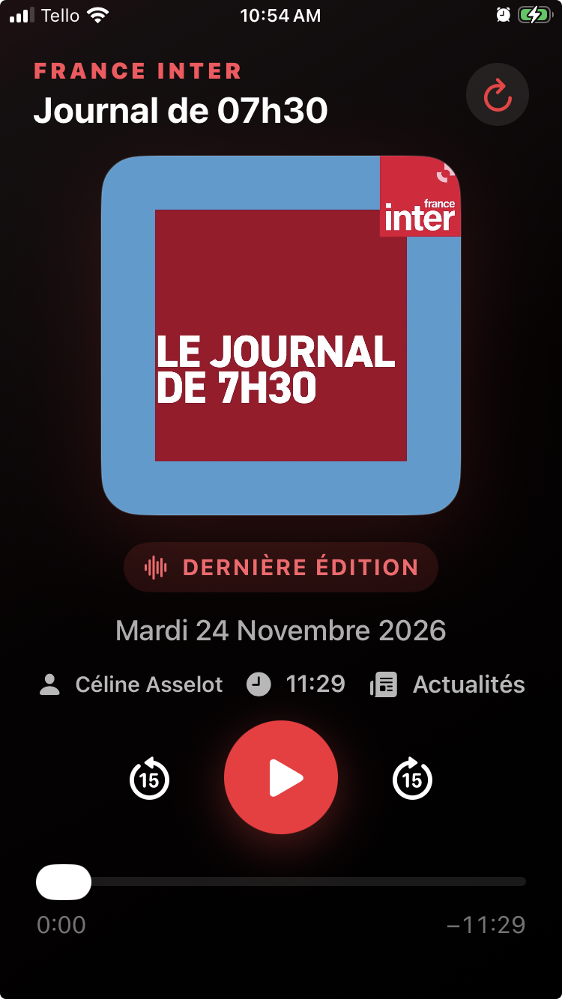

# Le Journal de 7h30

A small SwiftUI app for listening to the latest **Journal de 7h30** from France Inter.

  

## Why I made it

I wanted a simple way to listen to the French morning news every day, wherever I was in the world. So I created this app and made it open source in the hope that it will be useful to others too.

## What it does

- Loads the official France Inter podcast RSS feed
- Selects the most recent 7:30 a.m. news bulletin automatically
- Displays the publication date, presenter, duration, and artwork
- Streams the audio without waiting for the entire episode to download
- Supports seeking, 15-second skips, background playback, and lock-screen controls

## Running the app

1. Open `FranceInter.xcodeproj` in Xcode.
2. Select your development team and a unique bundle identifier if needed.
3. Choose an iPhone or simulator and press **Run**.

The app has no third-party dependencies. It uses SwiftUI, Foundation, AVFoundation, and MediaPlayer.

## Acknowledgements

The podcast feed, audio, artwork, and France Inter name belong to Radio France. This is an independent, unofficial app and is not affiliated with or endorsed by Radio France.
